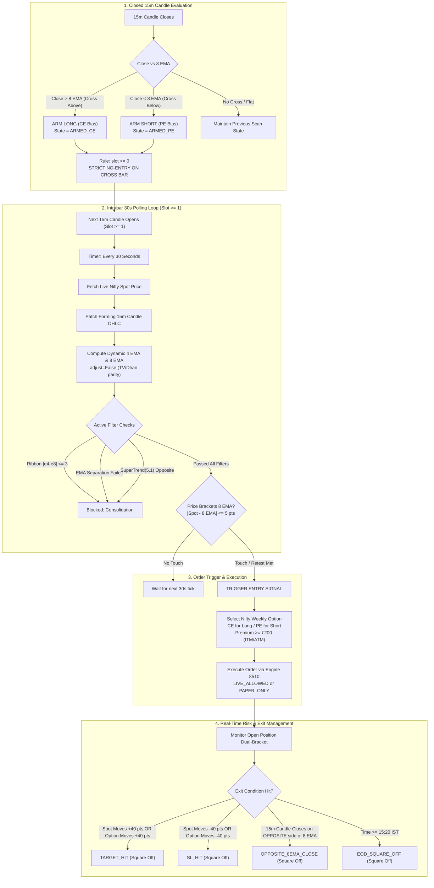

# 8 EMA Prototype — Technical Architecture & Strategy Specification

## Executive Summary

The **8 EMA Prototype** is a dedicated, standalone algorithmic trading lane operating within the **Port 8510 Algorithmic Trading Workspace**. It is specifically engineered to trade **Nifty 50 Index Options** using **15-minute Spot Price Action** paired with a **high-frequency (30-second) dynamic intrabar retouch entry**.

> [!IMPORTANT]
> **Standalone Architecture**: The 8 EMA Prototype is completely isolated from:
> - **Stage 2 / Stage 3**: Closed-bar Bollinger Band expansion setups ($BB > 60$).
> - **4×8 EMA Crossover**: Reversal crossover strategy with 2-bar wait rules.
> - **1 HR Flagship**: Higher-timeframe swing-zone price action strategy.
>
> In the backtester and replay engines, it is tracked exclusively under the strategy identifier `EMA8_PROTOTYPE` (`EMA8_PROTOTYPE_LONG` / `EMA8_PROTOTYPE_SHORT`).

---

## 1. Architectural Workflow



---

## 2. Configuration Parameters

Configuration resides in [`analyst/terminal8510_config.json`](file:///home/harish/Documents/Swathi%20K%20N/1%20Trading/option%20chain/OC/analyst/terminal8510_config.json) under the block `"scanner.ema8_prototype"`.

| Parameter | Type | Default | Description |
| :--- | :--- | :--- | :--- |
| `enabled` | `boolean` | `true` | Master switch for the prototype lane. |
| `execution_mode` | `string` | `"LIVE_ALLOWED"` | Execution authority: `"LIVE_ALLOWED"` routes real orders to Dhan API when live trading is armed; `"PAPER_ONLY"` restricts execution to simulated paper ledger. |
| `touch_tol_pts` | `float` | `5.0` | Maximum distance (in Nifty spot points) between spot price and dynamic 8 EMA to qualify as a valid touch/retest. |
| `target_pts` | `float` | `40.0` | Target profit threshold for both Nifty spot and option contract. |
| `sl_pts` | `float` | `40.0` | Stop-loss threshold for both Nifty spot and option contract. |
| `e8_refresh_seconds` | `float` | `30.0` | Intrabar polling frequency for dynamic EMA and touch evaluations. |
| `min_option_premium_inr` | `float` | `200.0` | Minimum option LTP threshold (targets deep ITM / near ATM strikes to guarantee delta $\ge 0.5$ and liquid fills). |
| `ribbon_filter_enabled` | `boolean` | `false` | Optional consolidation filter. |
| `ribbon_max_pts` | `float` | `3.0` | Threshold band for ribbon squeeze. If $\|e4 - e8\| \le 3.0$, trade is blocked. |
| `ema_separation_enabled` | `boolean` | `false` | Optional filter requiring $e4 > e8$ for Longs and $e4 < e8$ for Shorts. |
| `supertrend_enabled` | `boolean` | `false` | Optional directional confirmation filter. |
| `supertrend_length` | `integer` | `5` | ATR length for SuperTrend indicator. |
| `supertrend_factor` | `float` | `1.0` | ATR multiplier factor for SuperTrend indicator. |
| `arm_until_opposite_close` | `boolean` | `true` | Arm remains active until an opposite 15m candle close flips or disarms it. |

---

## 3. Mathematical Models & Indicators

### 3.1 Dynamic Exponential Moving Average (EMA)
The engine calculates EMAs adhering strictly to TradingView and Dhan platform specifications using exponential weighted moving averages (`adjust=False`):

$$\alpha = \frac{2}{N + 1}$$

- For 4 EMA: $\alpha_4 = \frac{2}{4 + 1} = 0.40$
- For 8 EMA: $\alpha_8 = \frac{2}{8 + 1} = \frac{2}{9} \approx 0.2222$

### 3.2 Dynamic Forming Bar Patching
During live trading and backtest replay, the current 15-minute candle is incomplete. To prevent lag and look-ahead bias, the forming bar is dynamically synthesized:

```python
def apply_forming_bar_to_b15(b15, *, bar_ci, live_spot, form_high=None, form_low=None):
    work = b15.copy()
    i = _idx_abs(bar_ci, len(work))
    work.iat[i, work.columns.get_loc("close")] = float(live_spot)
    if form_high is not None:
        work.iat[i, work.columns.get_loc("high")] = max(float(form_high), float(live_spot))
    if form_low is not None:
        work.iat[i, work.columns.get_loc("low")] = min(float(form_low), float(live_spot))
    return work
```

The dynamic 8 EMA value at tick time $t$ is calculated by evaluating the full series up to the patched bar:

$$(e_4, e_8) = \text{ema4\_ema8}(\text{work}["\text{close}"])$$

---

## 4. Entry State Machine (A to Z)

The execution lane is governed by the state machine implemented in [`analyst/ema8_prototype_8510.py`](file:///home/harish/Documents/Swathi%20K%20N/1%20Trading/option%20chain/OC/analyst/ema8_prototype_8510.py).

### Phase 1: Scanning & Arming (`WAITING_FOR_CLOSE` $\rightarrow$ `ARMED`)
Arming is evaluated strictly on closed 15-minute bars.

#### Long Arm Condition (`ARMED_CE`)
1. Previous candle close was at or below the 8 EMA: $\text{Close}_{i-1} \le \text{EMA}_{8, i-1}$.
2. Current candle close finishes strictly above the 8 EMA: $\text{Close}_i > \text{EMA}_{8, i}$.
3. Alternatively, candle opens at or below 8 EMA and closes above: $\text{Open}_i \le \text{EMA}_{8, i} \text{ and } \text{Close}_i > \text{EMA}_{8, i}$.
4. State is stored: `proto_state["arm"] = {"direction": "LONG", "cross_i": i, "cross_e8": e8}`.

#### Short Arm Condition (`ARMED_PE`)
1. Previous candle close was at or above the 8 EMA: $\text{Close}_{i-1} \ge \text{EMA}_{8, i-1}$.
2. Current candle close finishes strictly below the 8 EMA: $\text{Close}_i < \text{EMA}_{8, i}$.
3. Alternatively, candle opens at or above 8 EMA and closes below: $\text{Open}_i \ge \text{EMA}_{8, i} \text{ and } \text{Close}_i < \text{EMA}_{8, i}$.
4. State is stored: `proto_state["arm"] = {"direction": "SHORT", "cross_i": i, "cross_e8": e8}`.

#### The Anti-Chase Rule (`slot <= 0`)
Entering immediately on the breakout bar exposes the strategy to adverse risk-reward (exhaustion wicks). Therefore:
$$\text{slot} = i - \text{cross\_i}$$
- When $\text{slot} \le 0$ (the crossing bar itself): Trade is **strictly prohibited**.
- The scanner reports: `"NO TRADE — No entry on crossing candle; wait for re-touch"`.

---

### Phase 2: Dynamic Retouch Entry (`ARMED` $\rightarrow$ `TRIGGERED`)
Once $\text{slot} \ge 1$ (subsequent 15m bars):
The intrabar background task polls every 30 seconds:
1. Dynamic 8 EMA is recalculated with live spot.
2. Price bracketing condition is tested:

```python
def _touch_retest(*, bullish: bool, low: float, high: float, e8: float, tol: float) -> bool:
    band_lo = e8 - tol
    band_hi = e8 + tol
    if bullish:
        return low <= band_hi and high >= band_lo
    return high >= band_lo and low <= band_hi
```

3. **Entry Trigger**: When the price touches within $\pm 5.0$ points of the dynamic 8 EMA:
   - Signal is emitted: `EMA8_PROTOTYPE_LONG` (CE) or `EMA8_PROTOTYPE_SHORT` (PE).
   - Entry Spot is logged: $\text{Spot}_{\text{entry}} = \text{round}(\text{EMA}_{8,\text{tick}}, 2)$.
   - Arm is consumed (`proto_state.pop("arm")`) to avoid double triggers.

---

## 5. Optional Confirmation Filters

The trader can toggle three precision filters in real time from the UI desk without restarting the server:

### 5.1 Ribbon Squeeze Filter (`ribbon_filter_enabled`)
Avoids false breakouts in tight consolidation regimes where EMAs intertwine:
$$\text{Block if } |e_4 - e_8| \le \text{ribbon\_max\_pts} \quad (\text{default: } 3.0 \text{ pts})$$

### 5.2 EMA Separation Filter (`ema_separation_enabled`)
Guarantees moving average momentum alignment:
- **Long Block**: If $e_4 \le e_8$ (4 EMA has not crossed above 8 EMA).
- **Short Block**: If $e_4 \ge e_8$ (4 EMA has not crossed below 8 EMA).

### 5.3 SuperTrend Confirmation Filter (`supertrend_enabled`)
Calculates SuperTrend on the forming 15m bar using True Range and ATR with length 5 and multiplier 1.0:
- Blocks **Long** entry if SuperTrend direction is `DOWN`.
- Blocks **Short** entry if SuperTrend direction is `UP`.

---

## 6. Contract Selection & Order Routing

When an entry signal triggers:
1. **Side Determination**:
   - Long spot signal $\rightarrow$ **CE BUY**
   - Short spot signal $\rightarrow$ **PE BUY**
   - Options are **always bought** (long premium).
2. **Contract Filtering**:
   - Only contracts from the **current weekly expiry** are considered.
   - Strike selection prioritizes high premium: $\text{LTP} \ge \text{₹}200.0$.
   - This selects Deep ITM or Near ATM strikes with $\Delta \approx 0.50 - 0.75$, ensuring high liquidity, low bid-ask spread, and direct delta responsiveness to spot moves.
3. **Execution Routing**:
   - `LIVE_ALLOWED`: Routes limit/market orders directly to the broker (Dhan API v2) when the desk is armed LIVE.
   - `PAPER_ONLY`: Enters orders into the real-time simulation ledger (`positions` table in `ledger.sqlite3`).

---

## 7. Exit Strategy & Risk Management

Positions are monitored by the 1-second tick loop in [`_monitor_open_positions()`](file:///home/harish/Documents/Swathi%20K%20N/1%20Trading/option%20chain/OC/analyst/terminal8510_backend.py#L6324).

```
+-----------------------------------------------------------------------------------+
|                        DUAL-SYMMETRIC EXIT SPECIFICATION                          |
+------------------------------+----------------------------------------------------+
| Exit Type                    | Exact Condition / Action                           |
+------------------------------+----------------------------------------------------+
| 1. Spot Target Hit           | Long: Spot >= Entry + 40                           |
|                              | Short: Spot <= Entry - 40                          |
|                              | Reason: SPOT_TARGET_HIT                            |
+------------------------------+----------------------------------------------------+
| 2. Spot Stop-Loss Hit        | Long: Spot <= Entry - 40                           |
|                              | Short: Spot >= Entry + 40                          |
|                              | Reason: SPOT_SL_HIT                                |
+------------------------------+----------------------------------------------------+
| 3. Option Target Hit         | Option LTP >= Option Entry + 40                    |
|                              | Reason: OPTION_TARGET_HIT                          |
+------------------------------+----------------------------------------------------+
| 4. Option Stop-Loss Hit      | Option LTP <= Option Entry - 40                    |
|                              | Reason: OPTION_SL_HIT                              |
+------------------------------+----------------------------------------------------+
| 5. Structural Emergency Exit | Long: 15m candle close < 8 EMA                     |
| (Same Bar or Subsequent)     | Short: 15m candle close > 8 EMA                    |
|                              | Note: Evaluated on the SAME entry candle at close  |
|                              | as well as any subsequent candle.                  |
|                              | Action: Immediate Market Square Off                |
|                              | Reason: OPPOSITE_8EMA_CLOSE                        |
+------------------------------+----------------------------------------------------+
| 6. EOD Square-Off            | Time >= 15:20 IST                                  |
|                              | Reason: EOD_SQUARE_OFF_15:20                       |
+------------------------------+----------------------------------------------------+
```

> [!NOTE]
> **Whichever condition triggers first closes the entire position.** If spot moves 40 points before the option moves 40 points, the spot exit triggers. If the option surges 40 points due to IV spike, the option target triggers.

---

## 8. Trailing Stop Architecture

### 8.1 Why Option Step-Trailing is Excluded
Other strategies on Port 8510 employ the "Dhan Super Trail" (+15 pt activation with +5 pt steps). However:
- In option contracts, minor pullbacks and implied volatility decay can prematurely stop out healthy spot trends.
- The 8 EMA Prototype explicitly disables the option step-trail (`trail_sl_enabled = False` in backtesting and live prototype mode).

### 8.2 The 8 EMA as the Dynamic Structural Trail
Instead of an arbitrary point step, **the 8 EMA itself serves as the dynamic trailing line**:
- As the market trends, each new 15m candle's 8 EMA moves higher (in Longs) or lower (in Shorts).
- The trade remains open to capture larger runner gains up to +40 points.
- If at any point the trend breaks and a 15-minute candle closes across the 8 EMA, the `OPPOSITE_8EMA_CLOSE` rule executes an instant square-off.

---

## 9. Backtesting & Replay Engine (A to Z)

The system includes a dedicated backtesting and historical replay pipeline to verify edge across multi-month historical data.

### 9.1 Matrix Multi-Month Backtester
- Located in [`analyst/terminal8510_backend.py`](file:///home/harish/Documents/Swathi%20K%20N/1%20Trading/option%20chain/OC/analyst/terminal8510_backend.py#L8415) and [`analyst/ema8_prototype_8510.py`](file:///home/harish/Documents/Swathi%20K%20N/1%20Trading/option%20chain/OC/analyst/ema8_prototype_8510.py#L695).
- Scans continuous 15-minute Nifty spot bars from `ict_smc.sqlite3` (~94,000 candles).
- Within each historical 15m bar, it retrieves the actual 1-minute candle slices (`day_1m`) and steps through them on a 30-second grid to recreate the exact intrabar dynamic EMA recalculation.

### 9.2 Data Provenance & Integrity
Implemented in [`analyst/algo_execution_master_8510.py`](file:///home/harish/Documents/Swathi%20K%20N/1%20Trading/option%20chain/OC/analyst/algo_execution_master_8510.py):
- **`IMMUTABLE_MASTER`**: Real live/paper executions recorded permanently. These include real option fill prices, broker order IDs, and net rupee P&L. Rows are append-only (never edited or deleted).
- **`SYNTHESIZED`**: Backtest replay rows. These report P&L strictly in **Nifty spot points** (`st_pnl_pts`) rather than simulated rupee amounts, avoiding synthetic option delta drift.

### 9.3 TradingView Lightweight Charts Visualizer
The Replay UI (`/api/replay/run` and `/api/replay/candles`) renders the session chart with:
1. **15m Candlestick Series**: Up green `#22c55e`, Down red `#ef4444`.
2. **4 EMA Line**: Light pink `#fda4af` (width: 2).
3. **8 EMA Line**: Light green `#86efac` (width: 2).
4. **Interactive Trade Markers**:
   - **Long Entry**: Bright green arrow below candle (`shape: arrowUp`, `#22c55e`).
   - **Short Entry**: Bright red arrow above candle (`shape: arrowDown`, `#ef4444`).
   - **Target Reached**: Emerald marker at the exit candle (`#10b981`).
   - **Stop-Loss Hit**: Prominent red marker (`size: 3`, `#dc2626`) annotated with exact timestamp and direction:
     `"STOP LOSS HIT ON LONG 11:45"`.

---

## 10. Codebase File Map & Placement

```
/home/harish/Documents/Swathi K N/1 Trading/option chain/OC/
├── analyst/
│   ├── ema8_prototype_8510.py          # Core strategy: State machine, dynamic EMA math, filters, backtest step
│   ├── algo_execution_master_8510.py   # Immutable execution ledger & data provenance tagging
│   ├── terminal8510_backend.py         # Intrabar worker, order routing, position monitor, replay API
│   ├── terminal8510_config.json        # Scanner parameters, thresholds, and filter switches
│   └── test_ema8_prototype_8510.py     # Comprehensive unit tests (100% passing)
├── Algorithmic_Trading_Workspace_8510.html # Port 8510 Desk UI (Live Telemetry card, filters, TV chart replay)
└── EMA8_PROTOTYPE_SPECIFICATION.md     # This comprehensive technical specification
```

---

## 11. Verification & Testing Commands

To run the unit test suite verifying the 8 EMA Prototype logic:

```bash
pytest -q analyst/test_ema8_prototype_8510.py
```

To run the algo execution master integrity suite:

```bash
pytest -q analyst/test_algo_execution_master_8510.py
```
